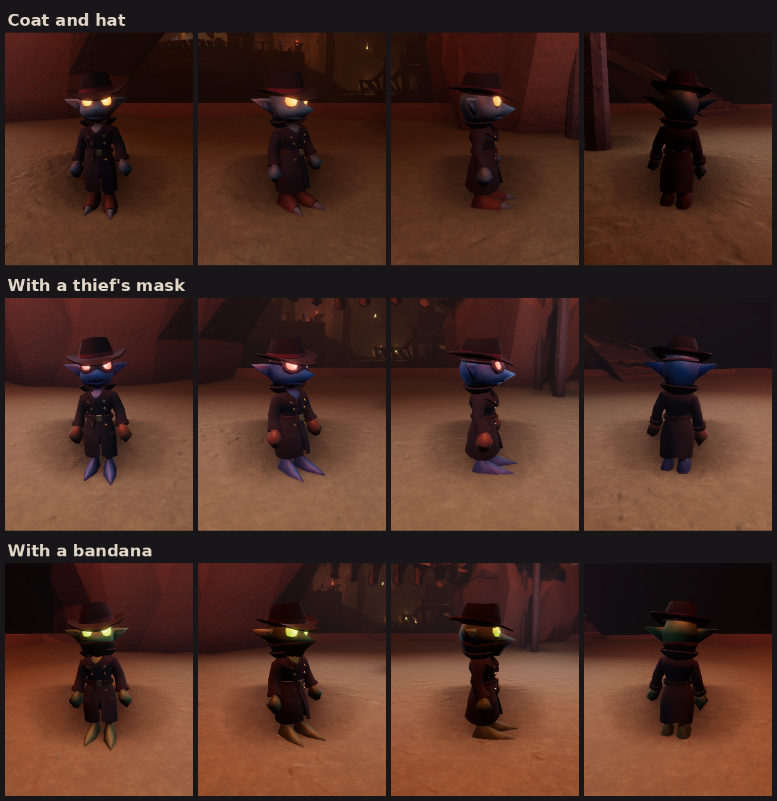
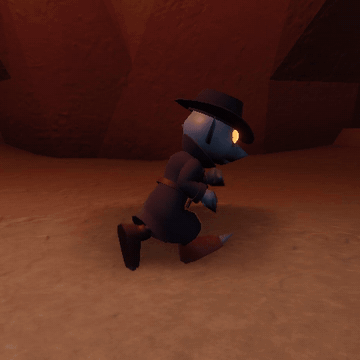

# Black Market

A goblin in a trench coat and a fedora sometimes keeps a dungeon merchant's stall instead of the merchant. He sells human things and
says his name is Nobody.

**Alpha.** He comes, trades and fights as described below, but what he sells may still change: items of mods to come may join his
goods.

- **The goods:** a crossbow, always with bolts beside it; bolts, which he never runs out of; a dagger; a ward; nine books of the old human
  mages (ghost, necromancy, greed, rat, chaos fire, void, berserking, engineering, mushroom head). His prices are the items' own; no faction
  likes or minds it.
- **Where:** at the dungeon's entrance, at four of the six stalls, on about a quarter of the visits where a merchant stands there. Never in a
  lobby.
- **Three looks:** plain, in a thief's mask, with a bandana over the mouth. Hurt him and he draws a dagger.
- **His clothes are yours once you have met him** (below).

## His costume

The coat and the hat stand in your wardrobe under a padlock. **Come within six metres of him in a dungeon** and both are yours from then
on: the coat among the clothes, the hat among the hair styles. Colour them as you like; the hat takes your hair colour. In the pictures
they are in the darkest colours.
Every player who has the mod finds them, the host and the others; a player who joins while the others are in a dungeon is a ghost there
and finds them on a later meeting.

His mask, bandana, gloves, trousers and shoes are the game's own; you open those the game's way.

What you have found is kept in `UserData/POGLib/Cosmetics.json` of your mod manager's profile, not in the game's save: a new save keeps
it; another profile or computer needs another meeting (or that file).

## Multiplayer

The host needs the mod. A player without it trades with him as with anyone, and sees him without the coat and the hat, under another name; they see
nobody's coat either. With the mod everyone sees them, on him and on each other.

## Settings

With [POG Config](https://thunderstore.io/c/pit-of-goblin/p/Largo/POG_Config/) (optional), for the host:

- page **POG Shops**: how often he comes (of the stalls he takes; 25% unless you say otherwise);
- page **Black Market**: how often each look comes up, and whose stalls he takes (from the next start of the game).

Without it the same is in `UserData/MelonPreferences.cfg` (`[POGLib_Shops_Merchants] POGBlackMarket`, from 0 to 1, and `[POGBlackMarket]`). `Sells` there
is a list of goods of your own instead of his, for example `Item_Crossbow+Item_CrossbowBolt:4, Item_CrossbowBolt*:1, Item_Key:2`: a name and a
weight; `+` the other one always stands beside it; `*` it does not run out. A mod's item is `Mod/Item`.

## Needs

[POGLib](https://thunderstore.io/c/pit-of-goblin/p/Largo/POGLib/) and [POGShops](https://thunderstore.io/c/pit-of-goblin/p/Largo/POGShops/)
(a mod manager installs both).

Source and issues: [github.com/largoz/POGBlackMarket](https://github.com/largoz/POGBlackMarket)
